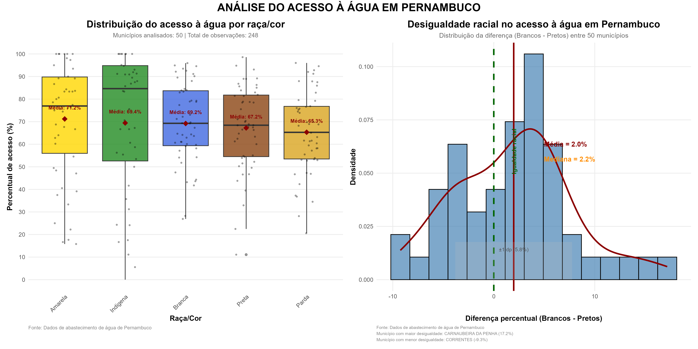
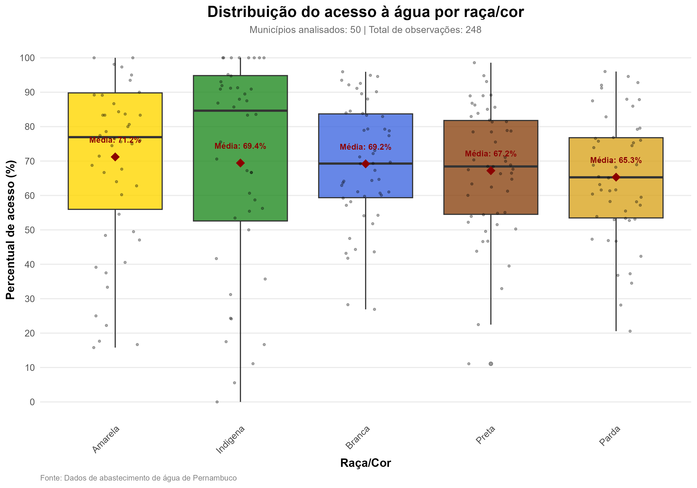
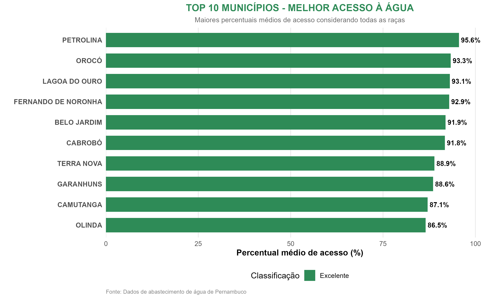
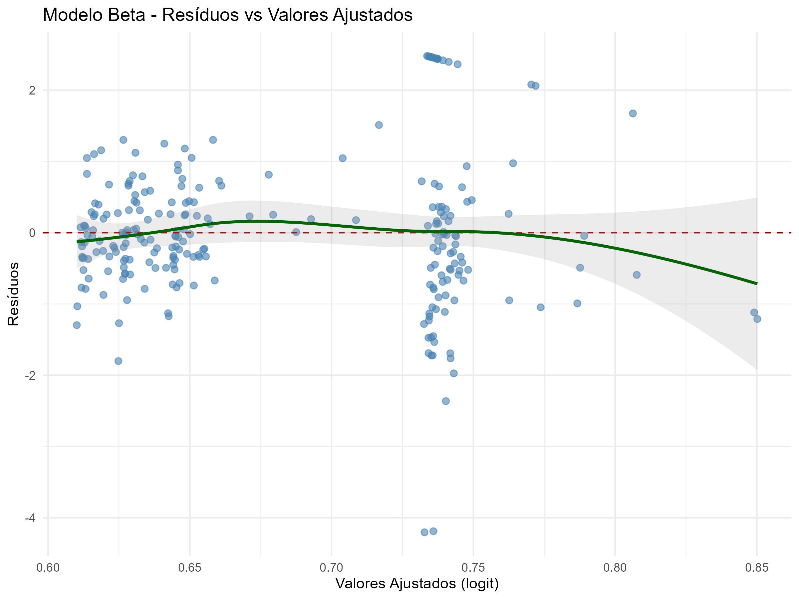

# Acesso à rede geral de água em Pernambuco — Métodos Estatísticos

**Pesquisa acadêmica | Engenharia de Produção (UFPE) | 2026**

Repositório do trabalho **“Uso de métodos estatísticos para entender o papel da variável raça e PIB per capita no acesso ao abastecimento de água em Pernambuco”**, desenvolvido na disciplina de **Métodos Estatísticos**. O projeto analisa dados do **Censo Demográfico 2022 (IBGE)** referentes aos municípios de Pernambuco, considerando a disponibilidade de ligação à rede geral de água, raça/cor e PIB per capita municipal.

> **Objeto da análise:** acesso à *infraestrutura da rede geral de distribuição de água*. Ter ligação à rede não significa necessariamente utilizá-la como fonte principal, nem garante continuidade, potabilidade ou qualidade do serviço. Essa distinção está descrita na metodologia do relatório.

## Autoria

O projeto foi desenvolvido conjuntamente por três estudantes e professora orientadora, nesta ordem conforme o relatório original:

1. **Hicaro Raffael Dionizio Silva**
2. **Isac Souto de Oliveira**
3. **Owah Kingsley Ahaolor**

1. **Isis Didier Lins**

A colaboração é atribuída aos três autores; o fato de o repositório estar hospedado no perfil de apenas um deles **não implica autoria individual**.

## Material do projeto

| Conteúdo | Acesso |
| --- | --- |
| Relatório acadêmico integral (PDF, 30 páginas) | [Ler relatório](relatorio/Relatorio_Metodos_Estatisticos_Agua_PE_2026.pdf) |
| Apresentação original (PowerPoint) | [Abrir slides](apresentacao/Apresentacao_Metodos_Estatisticos_Agua_PE_2026.pptx) |
| Amostra 1 — script R, dados e resultados | [Acessar arquivos](analises/amostra-1/) |
| Amostra 2 — script R, dados e resultados | [Acessar arquivos](analises/amostra-2/) |
| Amostra 3 — script R, dados e resultados | [Acessar arquivos](analises/amostra-3/) |
| Síntese dos resultados e limitações | [Ler síntese](docs/RESULTADOS_E_INTERPRETACAO.md) |
| Como executar o código | [Guia de reprodução](docs/REPRODUCAO.md) |
| Referências para citação | [Como citar](docs/COMO_CITAR.md) |

## Questão de pesquisa

Como o acesso à rede geral de abastecimento de água varia entre os municípios de Pernambuco e qual é a associação observada com **raça/cor** e **PIB per capita**?

## Metodologia

- **Fonte:** Censo Demográfico 2022, IBGE; dados municipais de PIB per capita utilizados na análise.
- **Amostragem:** três amostras municipais de 50 municípios cada, com observações organizadas por grupos de raça/cor. Os tamanhos válidos de algumas análises são inferiores ao número teórico devido a registros ausentes ou inválidos.
- **Análise exploratória:** distribuições de acesso, estatísticas descritivas, boxplots, rankings municipais, histogramas e mapas.
- **Inferência:** teste de Levene, ANOVA clássica e de Welch, tabelas de contingência, teste qui-quadrado e V de Cramér.
- **Modelagem:** regressão linear múltipla, modelo com transformação logarítmica e regressão beta, com diagnósticos de resíduos e critérios de comparação.
- **Ferramenta dos scripts fornecidos:** linguagem **R**; cada amostra inclui arquivos de entrada `.xlsx`, resultados e gráficos.

Detalhes, definições operacionais, hipóteses e referências estão no [relatório integral](relatorio/Relatorio_Metodos_Estatisticos_Agua_PE_2026.pdf).

## Principais resultados relatados

| Indicador | Resultado apresentado no trabalho |
| --- | --- |
| População estadual analisada | **9.018.330 pessoas** |
| Pessoas com ligação à rede geral | **6.892.175** |
| Pessoas sem ligação à rede geral | **2.126.155** |
| ANOVA de Welch | Não rejeição de igualdade das médias nas três amostras (p = 0,6865; 0,6940; 0,9026) |
| Qui-quadrado | Associação estatisticamente detectável entre raça/cor e acesso, com p < 0,001 nas três amostras |
| V de Cramér | Associação de magnitude pequena: **0,083; 0,076; 0,0537** |
| Regressões | Modelos com transformações e modelo beta apresentaram comportamentos distintos; PIB per capita teve associação positiva em análises específicas |

Esses números refletem os **resultados apresentados no relatório**, e não uma nova execução ou auditoria dos cálculos. As comparações entre modelos e as interpretações precisam considerar os pressupostos e a composição das amostras. **Associação estatística não comprova causalidade.**

## Exemplos de visualizações

| Distribuição e indicadores — Amostra 1 | Distribuição por raça/cor — Amostra 1 |
| :---: | :---: |
|  |  |

| Rankings municipais — Amostra 1 | Diagnósticos do modelo beta — Amostra 1 |
| :---: | :---: |
|  |  |

Os gráficos completos das três amostras estão nas respectivas pastas `graficos/`. Os mapas interativos `mapa_abastecimento_amostral.html` podem ser abertos localmente no navegador; componentes externos podem requerer conexão com a internet.

## Estrutura do repositório

```text
.
├── README.md
├── CITATION.cff
├── .gitignore
├── relatorio/
├── apresentacao/
├── analises/
│   ├── amostra-1/
│   │   ├── T7.R
│   │   ├── *.xlsx
│   │   ├── graficos/
│   │   └── mapa_abastecimento_amostral.html
│   ├── amostra-2/
│   └── amostra-3/
├── docs/
│   ├── RESULTADOS_E_INTERPRETACAO.md
│   ├── REPRODUCAO.md
│   └── COMO_CITAR.md
```

## Reprodutibilidade

Para executar a análise de uma amostra, abra um terminal na pasta correspondente e execute `Rscript T7.R` com **R** instalado. Os arquivos Excel de entrada precisam permanecer nessa pasta, pois o código usa caminhos relativos. Veja os requisitos, o comportamento do script e as limitações de reprodutibilidade no [guia](docs/REPRODUCAO.md).


## Fonte e responsabilidade

Fonte central: **IBGE — Censo Demográfico 2022**, com recorte estadual de Pernambuco. O projeto é uma produção acadêmica independente para fins didáticos; não representa posicionamento institucional do IBGE ou da UFPE. Os resultados e interpretações são responsabilidade dos autores.

## Uso de Inteligência Artificial

O uso do ChatGPT esteve presente no desenvolvimento desse estudo e na revisão dos códigos, no esclarecimento de conceitos técnicos, no apoio à análise dos resultados e na revisão do texto. As recomendações e sugestões foram avaliadas criticamente pelos autores. Os autores assumem total responsabilidade pelas informações e conclusões apresentadas.
